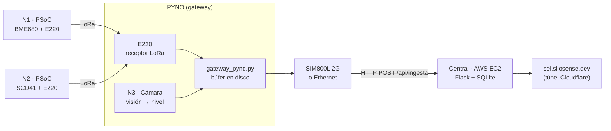
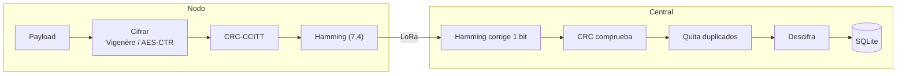

# Boya de monitoreo ambiental — SEI (UTEC)

Boya flotante para lagos y ríos que mide variables ambientales y el nivel del agua, y avisa cuando hay crecida (red LoRa de alerta de crecidas).
Proyecto del curso **Sistemas Embebidos (SEI)** — UTEC, 2026-2. Web de monitoreo: **https://sei.silosense.dev**

## ¿Qué mide?

| Nodo | Placa | Sensor | Variables |
|---|---|---|---|
| N1 | PSoC #1 | BME680 | Temperatura, humedad relativa, presión, gas (calidad del aire) |
| N2 | PSoC #2 | SCD41 | CO₂, temperatura, humedad relativa |
| N3 | PYNQ | Cámara | Altura del agua leyendo una **regla limnimétrica** con procesamiento de imagen |

Estados del nivel (en `internet/config.py`): **vigilancia** ≥ 50 cm, **alerta** ≥ 100 cm o si sube 10 cm en 10 min.

## Arquitectura



Mientras no llegue la radio real, un simulador en el servidor genera datos de los 3 nodos.

### Trama

```
| ver | tipo | nodo |  seq  |   timestamp   | largo |  payload (cifrado)  | CRC-16 |
|  1  |  1   |  1   |   2   |       4       |   1   |          n          |   2    |  bytes, big-endian
```



Detalle de la trama, la API y los métodos de cada página web en [`internet/README.md`](internet/README.md).

## Estructura del repositorio

```
.
├── camara/                  # Procesamiento de imagen para leer la regla limnimétrica
│   ├── main_1.mlx           # Live Script de MATLAB (prototipo del algoritmo)
│   └── ref06_...jpg         # Imagen de prueba que usa main_1.mlx
├── internet/                # Central de monitoreo (web + base de datos) y gateway de la PYNQ
│   ├── gateway/             # Script del gateway: LoRa (E220) -> búfer -> internet o SIM800L
│   └── README.md            # Trama, API de ingesta, métodos de la ppt; web en https://sei.silosense.dev
├── mecanica/boya/           # Diseño 3D paramétrico de la boya (CadQuery → STL/STEP) y renders en Blender
├── regla/                   # Regla para imprimir (44 cm + ArUco, 2 hojas A4) y su generador
├── imagenes_referencia/     # Fotos de reglas limnimétricas reales para probar el algoritmo
│   └── CREDITOS.md          # Autor y licencia de cada imagen
└── presentacion/            # Diapositivas de avance (.pptx, se editan en Canva)
```

## Medición del nivel del agua (cámara)

El prototipo está en `camara/main_1.mlx`. Recibe una imagen y devuelve un número: el nivel del agua en metros.

1. **Umbralización de blancos**: se quedan los píxeles con R, G y B ≥ 200 (las franjas blancas de la regla).
2. **Apertura** (`strel('disk',10)`): elimina manchas blancas pequeñas (reflejos, olas).
3. **Cierre** (`strel('disk',50)`): une las franjas en un solo bloque.
4. **Rectángulo envolvente**: se recorta la imagen original a la zona de la regla.
5. **Binarización** de la regla recortada.
6. **Período de las franjas**: en la mitad central de las columnas se mide el largo (en píxeles) de cada franja blanca y negra; se toma la mediana de cada una.
7. **Altura**: con el período en píxeles se calcula cuántos centímetros de regla quedan visibles sobre el agua y se restan de la longitud total de la regla (200 cm).

### Cómo ejecutarlo

1. Abrir MATLAB (con **Image Processing Toolbox**).
2. Ir a la carpeta `camara/` (la imagen se lee con ruta relativa).
3. Abrir `main_1.mlx` y ejecutar (*Run*).

Para probar con otra imagen, cópiala a `camara/` y cambia el nombre en la línea `imread(...)`.

### Limitaciones actuales

- Supone una regla de 200 cm y un período de franja fijo; hay que ajustarlo a la regla real que usemos.
- El umbral de blancos (200) depende de la iluminación; con sol fuerte, sombras o de noche puede fallar.
- Todavía no corrige perspectiva ni inclinación de la cámara (la boya se mueve con las olas).

## Hardware

| Parte | Elegido |
|---|---|
| Nodos de aire | 2 × PSoC con BME680 (N1) y SCD41 (N2) |
| Visión + gateway | PYNQ con cámara (N3) |
| Radio | LoRa Ebyte E220-400T22S en cada nodo y en el gateway |
| Salida a internet | SIM800L (2G, comandos AT) o Ethernet de la PYNQ |
| Servidor | AWS EC2 (Flask + SQLite) detrás de un túnel de Cloudflare |

Conexiones y configuración del E220 y el SIM800L: [`internet/gateway/README.md`](internet/gateway/README.md).

_Por definir:_ alimentación (batería / panel solar) y carcasa flotante.

## Estado (9-nov-2026)

- [x] Algoritmo de la regla en MATLAB (funciona con la imagen de prueba)
- [x] Central web en AWS, con simulador de los 3 nodos
- [x] Trama, CRC, Hamming y cifrado, con pruebas
- [x] Gateway probado sin hardware (E220 simulado, central real)
- [ ] Configurar los E220 y probar el enlace real PSoC → PYNQ
- [ ] Llevar la visión a la PYNQ (`publicar_nivel`)
- [ ] Probar el SIM800L con un chip en Lima (`AT+CREG?`)
- [ ] Firmware de los nodos PSoC
- [ ] Alimentación y carcasa flotante

## Imágenes de referencia

Las fotos de `imagenes_referencia/` son de **Wikimedia Commons** y tienen licencias Creative Commons (CC BY / CC BY-SA).
El autor y la licencia de cada una están en [`imagenes_referencia/CREDITOS.md`](imagenes_referencia/CREDITOS.md). Si se reutilizan (informe, presentación), hay que citar al autor.

## Equipo

| Nombre | Rol |
|---|---|
| Carlos Lam | |
| Raith726 (GitHub) | Central web y gateway |
| | |

## Cómo colaborar

```bash
git clone https://github.com/car-lam/boya_SEI.git
cd boya_SEI
# crear una rama para tu parte
git checkout -b nombre-de-tu-rama
# ... cambios ...
git add .
git commit -m "Describe qué hiciste"
git push -u origin nombre-de-tu-rama
```

Luego abre un *Pull Request* en GitHub para que el resto lo revise antes de unirlo a `main`.

- No subir contraseñas de WiFi, tokens ni claves de API (usar un archivo `secrets.h` o `.env`, que ya está en `.gitignore`).
- Evitar subir videos o datasets muy pesados; compartirlos por Drive y poner el enlace aquí.
