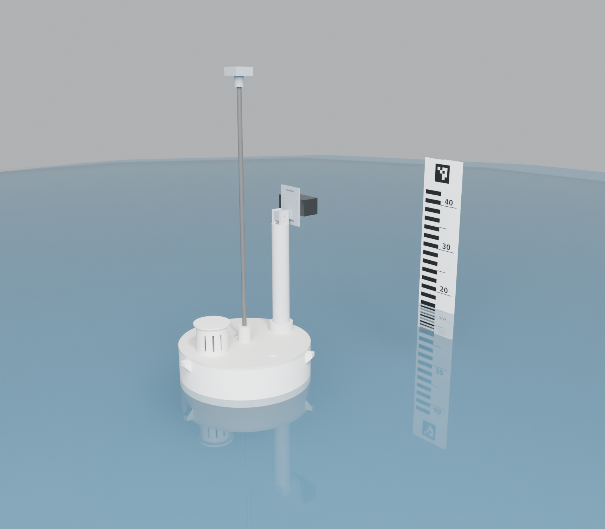
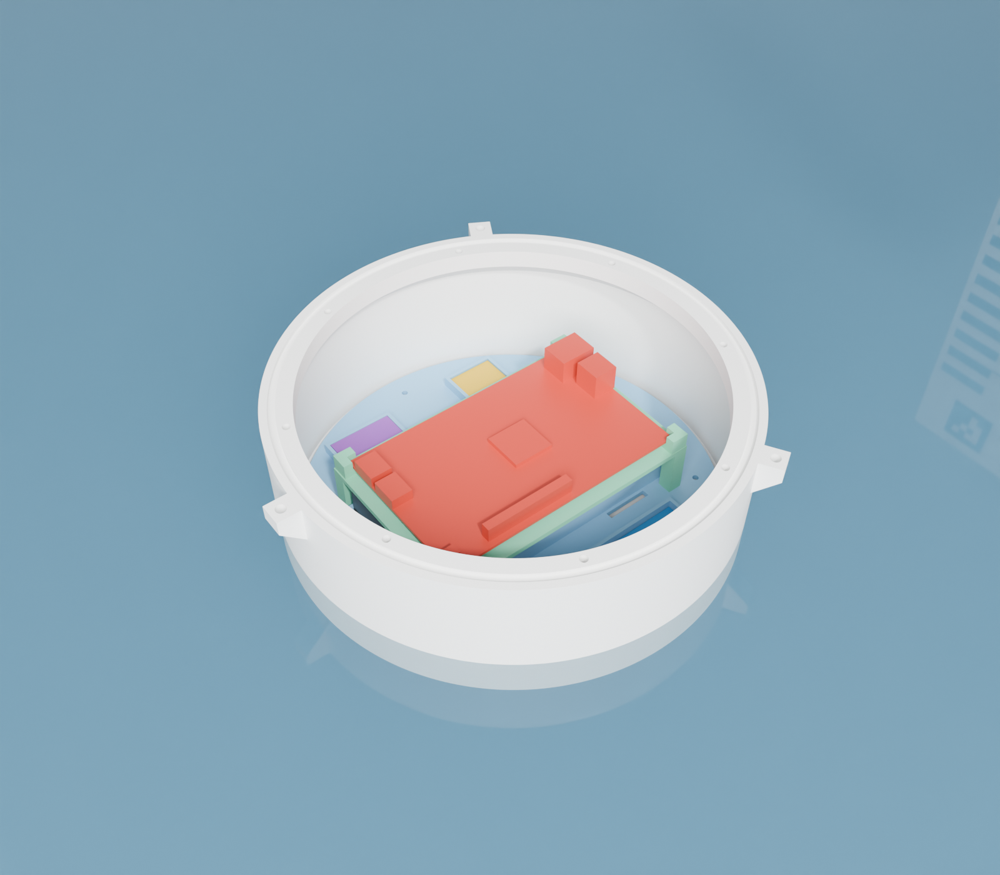

# Boya SEI: diseño 3D del MVP

Es un disco ancho y bajo (Ø240 × 95 mm), con un mástil para la cámara y un palo flexible para medir el viento. Todo el modelo es paramétrico y está en `boya.py` (CadQuery). Si cambias una medida al inicio del script y lo vuelves a correr, se regeneran los STL, los STEP, los renders y `resumen.json`.

```bash
# una vez (fuera del repo):
python3 -m venv ~/codigo/universidad/cursos/SEI/.venv-cad
~/codigo/universidad/cursos/SEI/.venv-cad/bin/pip install cadquery trimesh matplotlib
# cada vez que cambies algo:
~/codigo/universidad/cursos/SEI/.venv-cad/bin/python boya.py
```




Render fotorrealista con Blender (Cycles). Incluye el agua a la altura del calado calculado y la regla de la feria a ~45 cm, frente a la cámara:

```bash
~/codigo/universidad/cursos/SEI/.venv-cad/bin/python boya.py   # exporta renders/ensamble_stl/
blender -b --factory-startup -P render_blender.py -- --muestras 160   # ~4 min con 20 núcleos
blender -b --factory-startup -P render_blender.py -- --rapido         # prueba en ~15 s
```

La PYNQ, el powerbank y la webcam del render son maniquíes simplificados, no modelos reales.

## Qué va dónde

- **+X** es el lado de la cámara: apunta a la regla, que está fija en la pared de la tina.
- **Dentro del casco**, sobre una bandeja removible:
  - El powerbank va abajo y hace de lastre.
  - La PYNQ-Z2 va encima, en un estante con patas.
  - Al costado van el PSoC 5LP (CY8CKIT-059), el E220 y la IMU de la base.
- **Sobre la tapa:**
  - El mástil de la cámara: tubo Ø32 con una bisagra M3 para regular la inclinación.
  - El palo del viento, en el centro, en un encaje ciego (la tapa sigue sellada).
  - La caseta ventilada del BME680 y el SCD41.
  - El pasamuros SMA de la antena.
  - El pasacables del IMU de la punta.
- **3 orejas de amarre** a 60°, 180° y 300°. Se amarran con cuerdas a pesos en el fondo de la tina para que la boya no gire y la cámara siga mirando la regla.

## Resultados del modelo (`resumen.json`)

| | |
|---|---|
| Masa total estimada | ~1,76 kg |
| Calado | ~40 mm |
| Francobordo | ~55 mm |
| Altura metacéntrica GM | ~34 mm (estable) |
| Cámara sobre el agua | ~30 cm |
| Altura total con el palo | ~58 cm |

Las masas de la electrónica son estimaciones. Antes de imprimir, pesen el powerbank, la PYNQ y la webcam, pongan los valores en `maniquies()` y vuelvan a correr el script.

## Antes de imprimir: medir y ajustar

Todas estas medidas son aproximadas. Mídanlas con calibrador y cámbienlas al inicio de `boya.py`:

- `PYNQ` (87 × 140 según Farnell y Hackerboards) y `PYNQ_ALTO`.
- `PSOC` (~120 × 30, del foro de Infineon).
- `E220`, `IMU` y `POWERBANK` (el de ustedes, no uno genérico).
- `WEBCAM` y `PALO_D`: el diámetro del palo que compren.
- `INSERTO_D`: el agujero que pide su inserto M3 (suele ser 4,0–4,2 mm).

## Piezas (impresora de 256 mm)

| Pieza | Tamaño (mm) | Cómo imprimirla |
|---|---|---|
| `casco` | 252 × 240 × 95 | Con el fondo sobre la cama. Entra justo por las orejas. |
| `tapa` | 240 × 240 × 40 | Cara plana sobre la cama. |
| `bandeja` | Ø224 × 15 | Plana. |
| `estante_pynq` | 152 × 98 × 43 | Al revés (plataforma sobre la cama), así las patas no necesitan soporte. |
| `mastil_camara` | Ø32 × 229 | De pie. |
| `soporte_camara` | 35 × 50 × 70 | Con la placa acostada. |
| `caseta_sensores` | Ø64 × 53 | Con el techo sobre la cama. |
| `punta_palo` | 34 × 34 × 32 | Con la abertura del bolsillo sobre la cama. |

**Para que el PLA no deje pasar agua:**
- 5 perímetros, 6 capas arriba y abajo, 0,2 mm de capa y 30 % de relleno.
- En el casco y la tapa, flujo levemente alto (~102 %).
- Aun así el PLA filtra entre capas: pinten el casco por fuera con resina epóxica o un sellador en spray.
- El PLA se ablanda al sol. Para una demo bajo techo está bien.

## Lista de compras

- Cordón de o-ring NBR de **3 mm**, unos 75 cm. Se corta a medida (~716 mm) y se pega en anillo con cianoacrilato.
- **11 insertos de latón M3** (8 para la tapa y 3 para la bandeja), 8 tornillos M3×10 para la tapa y 3 M3×8 para la bandeja.
- 1 tornillo M3×25 con tuerca autoblocante para la bisagra de la cámara.
- Pigtail u.FL → SMA hembra de mamparo y la antena de 433 MHz.
- Palo flexible Ø8 de ~45 cm (fibra de vidrio o carbono) y 2 IMU BNO055 o BNO085.
- Cinta velcro (powerbank y webcam), bridas, silicona neutra o pegamento caliente para sellar el cable USB de la webcam en la base del mástil y el pasacables del palo.
- Cuerda y 3 pesos para el amarre.

## Armado

1. Insertos en el casco con el cautín: 8 en el reborde y 3 en el piso.
2. Prueba de estanqueidad **sin electrónica**: papel toalla dentro, tapa cerrada y 30 min en la tina con peso encima. Si el papel sale seco, se puede seguir.
3. Bandeja: el PSoC, el E220 y la IMU en sus marcos con una gota de pegamento caliente, y el powerbank con velcro.
4. Estante: la PYNQ en los postes de las esquinas, fijada con brida o velcro. Se encaja en la bandeja con las 4 clavijas.
5. Tapa: el mástil pegado en su encaje, el cable USB de la webcam pasado por dentro y sellado abajo. El palo pegado en el centro, con el cable del IMU de la punta por el pasacables y sellado. La caseta de sensores encajada en su anillo.
6. Cerrar sobre el o-ring apretando los 8 tornillos en cruz.

## Pendiente

- Confirmar las medidas reales de la electrónica (ver arriba).
- Ver si el palo y el mástil de la cámara perturban el viento que mide el palo. Si molestan, se mueve el palo más lejos o más alto.
- Con la cámara elegida, comprobar que a 40–50 cm de la regla se vea desde el agua hasta el ArUco. Si no alcanza, montarla girada 90°.
