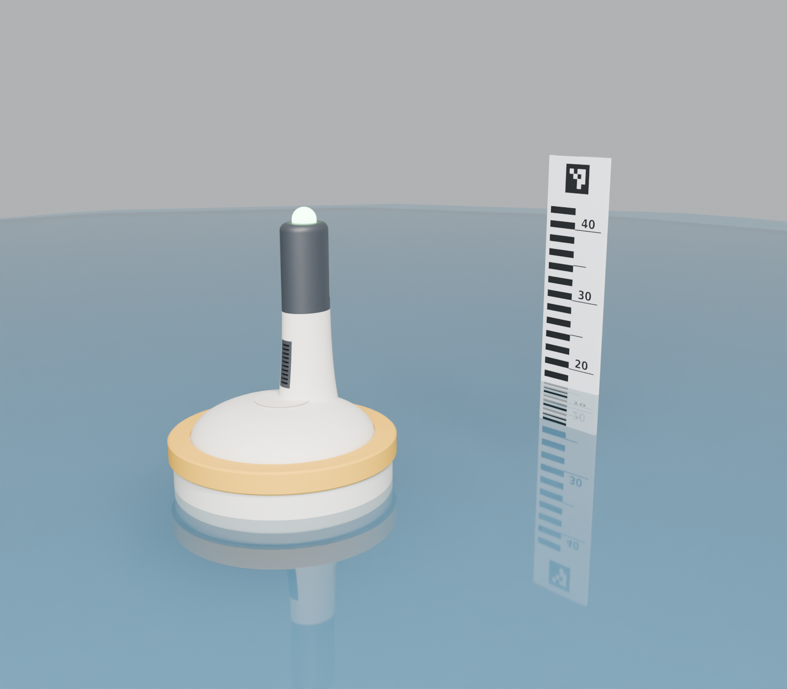

# Boya SEI: diseño 3D del MVP (concepto «canto rodado»)


La boya está pensada como un objeto de diseño, no solo como una caja que flota:

- **Casco:** fondo cónico suave.
- **Cubierta:** abombada.
- **Unión casco-tapa:** una banda amarilla de TPU. Tapa la junta y los tornillos y sirve de parachoques.
- **Torre:** sale de la cubierta y lleva todo lo que asoma:
  - la cabeza con la cámara detrás de un visor plano,
  - el farol LED de estado,
  - la rejilla de los sensores,
  - la antena, por dentro.

El modelo es paramétrico y está en `boya.py` (CadQuery). Si cambias una medida al inicio del script y lo vuelves a correr, se regeneran los STL, los STEP, los renders rápidos, `resumen.json` y el ensamble para Blender.

```bash
# una vez (fuera del repo):
python3 -m venv ~/codigo/universidad/cursos/SEI/.venv-cad
~/codigo/universidad/cursos/SEI/.venv-cad/bin/pip install cadquery trimesh matplotlib
# cada vez que cambies algo (~1 min):
~/codigo/universidad/cursos/SEI/.venv-cad/bin/python boya.py
# render fotorrealista (Cycles, ~7 min con 20 núcleos; --rapido para una prueba de ~15 s):
blender -b --factory-startup -P render_blender.py -- --muestras 128
```




La PYNQ, el powerbank y la webcam del render son maniquíes simplificados, no modelos reales.

## Diseño

| Elemento | Qué hace |
|---|---|
| **Casco** (hueso) | Ø240 × 95 mm. Fondo cónico a 45° con curvas amplias, para imprimirlo sin soportes. Por dentro lleva la bandeja de la electrónica. |
| **Banda** (amarillo IALA, TPU) | Tapa la unión y los 8 tornillos M3, protege contra las paredes de la tina y se engancha en un surco del casco. El amarillo no es solo estético: según la norma IALA, las boyas de datos son marcas especiales, que son amarillas. |
| **Cubierta + torre** (hueso) | Una sola pieza. La cubierta es abombada y la torre, de sección elíptica, se ensancha en la base para crecer de la cubierta. Es hueca: por dentro pasan los cables y la antena de 433 MHz (λ/4 ≈ 17 cm, el PLA no la bloquea). |
| **Cámara de sensores + rejilla** (carbón) | Atrás de la torre hay una caja sellada para el BME680 y el SCD41, abierta al aire solo por una rejilla que encaja al ras de la superficie. |
| **Cabeza** (carbón) | La webcam va en vertical, para tener más campo hacia arriba y ver toda la regla. Mira por una ventana de acrílico Ø30 empotrada en un visor plano. Lleva un collar abajo que calza con la torre. |
| **Farol** (translúcido) | LED de estado: verde = normal, ámbar = vigilancia, rojo = alerta. |
| **Ojales de amarre** | Tres, debajo del casco, invisibles desde arriba. Se amarran con cuerdas a pesos para que la boya no gire y la cámara siga mirando la regla. |

**+X** es el lado de la cámara, que apunta a la regla fija en la pared de la tina, a 40–50 cm. El palo del viento quedó fuera del diseño hasta que se defina.

## Resultados del modelo (`resumen.json`)

| | |
|---|---|
| Masa total estimada | ~2,2 kg |
| Calado | ~51 mm (la banda queda ~28 mm sobre el agua) |
| Altura metacéntrica GM | ~26 mm (estable) |
| Lente sobre el agua | ~23 cm (a la mitad de la regla de 44 cm) |
| Altura total | ~35 cm |

**Cómo se estima la masa:** cada pieza impresa cuenta 5 perímetros (~2,2 mm) más 15 % de relleno, y la electrónica va con pesos estimados en `maniquies()`. Antes de imprimir, pesen el powerbank, la PYNQ y la webcam y vuelvan a correr el script.

**Lastre:** con `LASTRE_G` se pueden agregar arandelas bajo la bandeja (hay 18 mm libres). 300 g solo suben GM a ~28 mm y le quitan 6 mm de borde libre, así que por ahora no hace falta.

## Antes de imprimir: medir y ajustar

Todas estas medidas son aproximadas. Mídanlas con calibrador y cámbienlas al inicio de `boya.py`:

- `PYNQ` (87 × 140 según Farnell y Hackerboards) y `PSOC` (~120 × 30, del foro de Infineon).
- `E220`, `IMU` y `POWERBANK` (el de ustedes).
- `WEBCAM`: la C270 sin el clip, en vertical, mide ~25 × 32 × 73. Si es otra, revisen que entre en la cabeza.
- `INSERTO_D`: el agujero que pide su inserto M3 (suele ser 4,0–4,2 mm).

## Piezas (impresora de 256 mm con AMS)

| Pieza | Material y color | Tamaño (mm) | Cómo imprimirla |
|---|---|---|---|
| `casco` | PLA hueso | 240 × 240 × 95 | Con el fondo sobre la cama. |
| `tapa_torre` | PLA hueso | 239 × 239 × 140 | Cara plana sobre la cama, con **soportes de árbol solo dentro** de la cúpula hueca. Se sacan por abajo. |
| `cabeza` | PLA carbón | 56 × 46 × 107 | De pie, con la espiga hacia abajo. |
| `rejilla` | PLA carbón | 10 × 18 × 52 | De pie. |
| `farol` | PLA/PETG translúcido | Ø26 × 16 | Con la base sobre la cama. |
| `banda` | **TPU** amarillo (95A) | Ø249 × 25 | Con el labio sobre la cama, desde un carrete externo: el AMS no lleva TPU. |
| `bandeja`, `estante_pynq` | PLA (cualquiera) | 224 × 224 × 15 / 152 × 98 × 43 | Plana; el estante al revés. |

**Para que no entre agua:**
- 5 perímetros, 6 capas arriba y abajo, flujo ~102 % en el casco y la tapa.
- Opcional: *fuzzy skin* en el casco y la torre, para un acabado mate que disimula las capas.
- El PLA filtra entre capas: pinten el casco por fuera con epóxica transparente o un sellador.
- Sellos con silicona neutra:
  - la ventana de acrílico en su asiento,
  - el farol en la cabeza,
  - la cabeza en la torre,
  - el paso de cables de la cámara de sensores.

## Lista de compras

- Cordón de o-ring NBR de **3 mm**, unos 75 cm. Se corta a ~716 mm y se pega en anillo con cianoacrilato.
- **11 insertos de latón M3** (8 para la tapa y 3 para la bandeja), 8 tornillos M3×10 de cabeza redonda y 3 M3×8.
- Disco de acrílico de Ø30 × 1 mm para la ventana (corte láser o una mica rígida).
- 1 LED WS2812 (o un anillo pequeño) para el farol.
- Pigtail u.FL y antena de 433 MHz tipo látigo de ~17 cm (o helicoidal) para dentro de la torre.
- Filamentos: PLA hueso, PLA gris carbón, PLA o PETG translúcido y TPU amarillo.
- Velcro, bridas, silicona neutra y cuerda con 3 pesos para el amarre.

## Armado

1. Insertos en el casco con el cautín: 8 en el reborde y 3 en las torres del piso.
2. Prueba de estanqueidad **sin electrónica**: papel toalla dentro, tapa cerrada y 30 min en la tina con peso encima. Si sale seco, se puede seguir.
3. Bandeja: PSoC, E220 e IMU en sus marcos y el powerbank con velcro. El estante con la PYNQ encaja en las 4 clavijas.
4. Torre: los sensores en su cámara, con el cable al conducto sellado con silicona, y la rejilla a presión.
5. Cabeza: la webcam entra por abajo. Se pega la ventana, se pone el LED con el farol, y la cabeza se pega en la torre. El cable USB y la antena bajan por dentro de la torre.
6. Cerrar sobre el o-ring apretando los 8 tornillos en cruz y estirar la banda de TPU hasta que enganche en el surco.

## Pendiente

- Medir la electrónica real y pesarla (ver arriba).
- Inclinación de la cámara: hoy queda horizontal. Si hace falta inclinarla, se calza con una cuña dentro de la cabeza.
- Comprobar en la tina que a 40–50 cm la cámara ve la regla desde el agua hasta el ArUco.
- Palo del viento: se agrega cuando se defina.
